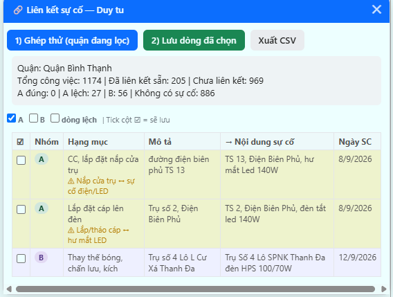
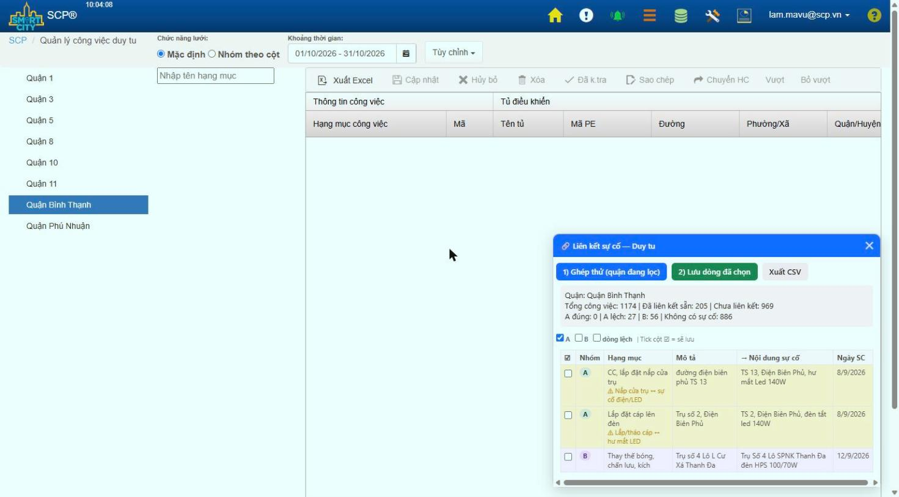
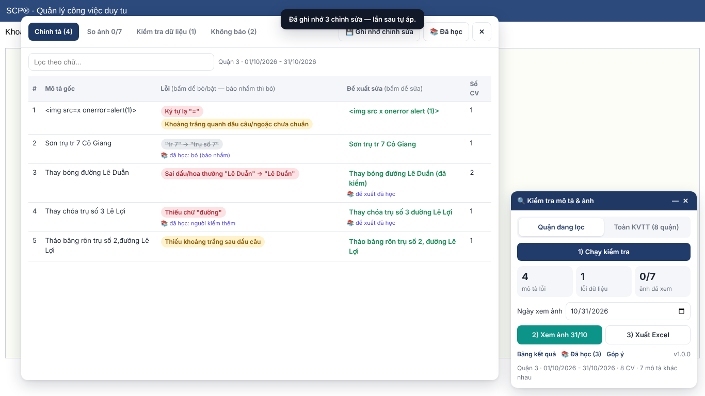
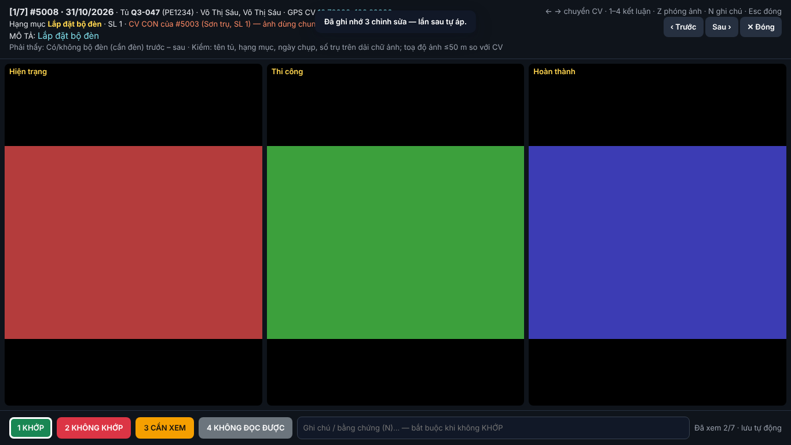

# Bộ công cụ hỗ trợ Duy tu — SmartHCM (SCP)

Ba **userscript** (chạy bằng Tampermonkey) hỗ trợ công tác duy tu trên trang
`https://www.smarthcm.city/Maintenance/TaskListNew` — Chiếu sáng Khu vực Trung Tâm.

> Miễn phí, không cần AI/API key. Chạy hoàn toàn trong tab trình duyệt đã đăng nhập của bạn — không gửi dữ liệu ra ngoài.

| # | Công cụ | File | Chức năng |
|---|---|---|---|
| 1 | **Liên kết sự cố — Duy tu** | [`lien-ket-su-co-smarthcm.user.js`](lien-ket-su-co-smarthcm.user.js) | Ghép và liên kết sự cố cho công việc duy tu (số trụ + vị trí + loại việc), duyệt bảng rồi lưu; tự học từ chỉnh sửa. |
| 2 | **Báo cáo duy tu trong ngày** | [`bao-cao-duytu-ngay.user.js`](bao-cao-duytu-ngay.user.js) | Tổng hợp kết quả duy tu **toàn KVTT** theo ngày, xuất **Word** mẫu hành chính. |
| 3 | **Kiểm tra mô tả & ảnh** | [`kiem-tra-mo-ta-anh.user.js`](kiem-tra-mo-ta-anh.user.js) | Soát **chính tả cột Mô tả** (có tự học), **kiểm tra dữ liệu ảnh** tự động, **xem ảnh nhanh** để kết luận Khớp/Không khớp, xuất **Excel**. Chỉ đọc. |

📄 Hướng dẫn chi tiết (Word): [`HuongDan-CongCu-DuyTu-SmartHCM.docx`](HuongDan-CongCu-DuyTu-SmartHCM.docx)

---

## 1. Cài Tampermonkey và bật quyền (làm 1 lần)

1. Cài extension **Tampermonkey** (https://www.tampermonkey.net/) cho Chrome/Edge/Cốc Cốc/Firefox.
2. `chrome://extensions` → bật **Developer mode** (góc trên phải).
3. `chrome://extensions` → Tampermonkey → **Chi tiết** → bật **Allow user scripts / Cho phép tập lệnh của người dùng**.
4. Chuột phải biểu tượng Tampermonkey → *Trang này có thể đọc và thay đổi dữ liệu* → **On all sites / Trên tất cả các trang**.

## 2. Cài công cụ

Mở từng link **Raw** dưới đây trong Chrome → Tampermonkey mở trang cài → bấm **Install**. Có `@updateURL` nên tự cập nhật khi có bản mới.

- Liên kết sự cố: https://raw.githubusercontent.com/neo-era/lien-ket-su-co-smarthcm/main/lien-ket-su-co-smarthcm.user.js
- Báo cáo duy tu trong ngày: https://raw.githubusercontent.com/neo-era/lien-ket-su-co-smarthcm/main/bao-cao-duytu-ngay.user.js
- Kiểm tra mô tả & ảnh: https://raw.githubusercontent.com/neo-era/lien-ket-su-co-smarthcm/main/kiem-tra-mo-ta-anh.user.js

Mở lại trang TaskListNew (Ctrl + F5) → các panel hiện ở góc phải dưới (kéo thanh tiêu đề nếu chồng nhau).

---

## 3. Công cụ 1 — Liên kết sự cố

### 3.1. Cách dùng

1. Mở trang **Quản lý Công việc Duy tu** (TaskListNew).
2. Lọc **Quận** và **Khoảng thời gian** như bình thường (công cụ chỉ xử lý đúng quận + thời gian đang lọc).
3. Góc phải dưới màn hình có panel **“🔗 Liên kết sự cố — Duy tu”**.
4. Bấm **“1) Ghép thử (quận đang lọc)”** → công cụ nạp lưới, lấy sự cố theo tủ và báo số liệu:
   - **A đúng** — khớp chắc (trùng số trụ + từ vị trí, trong vòng 45 ngày).
   - **A lệch** — khớp số trụ nhưng công cụ nghi ngờ ghép sai (tô vàng, bỏ tick sẵn).
   - **B** — chưa chắc (khác tên đường, chỉ trùng vật tư, hoặc nhiều sự cố ngang nhau).
   - **Không có sự cố** — không tìm được sự cố phù hợp.
5. Duyệt bảng (bật/tắt hiển thị A / B / dòng lệch). Cột **☑** đầu mỗi dòng quyết định dòng đó có được lưu hay không.
6. Bấm **“2) Lưu dòng đã chọn”** → công cụ lưu liên kết, tải lại lưới và báo số dòng lưu đúng.
7. (Tùy chọn) **“Xuất CSV”** để mở bằng Excel duyệt tay trước.

### 3.2. Nguyên tắc an toàn

- Luôn **chạy thử trước** (nút 1), xem bảng rồi mới lưu (nút 2).
- **Không ghi đè:** công việc đã có sự cố (API trả mã `2`) được bỏ qua.
- Mặc định chỉ tick sẵn **nhóm A không lệch**. Dòng lệch và nhóm B phải tự tick nếu muốn lưu.

### 3.3. Bộ lọc dòng lệch sẵn có

Công cụ tự đánh dấu “lệch” các kiểu ghép sai thường gặp:

| Kiểu lệch | Ví dụ |
|---|---|
| Nắp cửa trụ ↔ sự cố điện/LED | “CC, lắp đặt nắp cửa trụ” ↔ “hư mắt LED” |
| Lắp/tháo cáp ↔ hư mắt LED | “Lắp đặt cáp lên đèn” ↔ “đèn tắt led 140W” |
| Hẻm ↔ cầu (khác vị trí) | “hẻm 243 Chu Văn An” ↔ “cầu Chu Văn An” |
| Lắp đèn/cần đèn ↔ hư RCBO | “Lắp đặt bộ đèn” ↔ “hư RCBO” |
| Tẩy rỉ/sơn ↔ hư chóa/gãy tay | “Sơn trụ trang trí” ↔ “bể chóa / gãy tay đèn” |
| Kích/chấn lưu/tụ ↔ bễ đế bông huệ | “Thay thế kích đèn” ↔ “bễ đế đèn bông huệ” |
| Khác Lô | “Lô L” ↔ “Lô SPNK” |
| Tháo băng rôn ↔ đèn tắt | — |

> **Hạn chế:** bản rule-based **không đọc hiểu ngữ nghĩa**. Dòng lệch kiểu **mới** (chưa có trong bảng trên) có thể vẫn
> lọt vào nhóm A — hãy liếc qua bảng trước khi lưu. Từ **v1.1.0**, công cụ tự học từ chỉnh sửa của bạn (xem mục 3.4),
> nên mỗi kiểu lệch mới chỉ cần sửa tay **một lần**.

#### Khớp thiết bị cấp tủ (v1.2.0)

Sự cố **cấp tủ** (RCCB/RCBO/ELCB, MCB, Contactor, tủ điều khiển/bộ lập trình) thường **không ghi số trụ** ở cả công việc
lẫn sự cố, nên luật số trụ bỏ sót. Từ v1.2.0, khi mô tả công việc **không có số trụ**, công cụ ghép theo **loại thiết bị
trong cùng tủ** (sự cố trong vòng 120 ngày):

- Tủ có **đúng 1** sự cố cùng loại thiết bị → nhóm **A**, tick sẵn, ghi chú *“⚙ thiết bị cấp tủ”*.
- Tủ có **nhiều** sự cố cùng loại → nhóm **B** (không tick), để bạn tự chọn.
- Mô tả có số trụ → luật cấp tủ không can thiệp.

### 3.4. Tự học từ chỉnh sửa (v1.1.0)

Công cụ **ghi nhớ cách bạn sửa** và tự áp dụng cho lần sau — không cần sửa code.

- Mỗi khi bấm **“Lưu”**, công cụ so **đề xuất ban đầu** với **tick cuối cùng** của bạn:
  - **Bỏ tick** một dòng công cụ đề xuất → học *“cặp này **sai**”*.
  - **Tick** một dòng công cụ không đề xuất → học *“cặp này **đúng**”*.
- Học theo **đặc trưng khái quát**: *loại việc × loại sự cố × quan hệ vị trí* (cùng/khác đường, khác Lô, hẻm↔cầu),
  **không** theo mã công việc/sự cố (vì mã đổi mỗi đợt). Nhờ vậy sửa **một lần** áp cho **mọi trụ/quận** tương tự.
- Lần ghép sau, dòng trùng đặc trưng đã học sẽ **tự bỏ/giữ tick** kèm ghi chú *“📚 đã học…”*.
  Công cụ **không bao giờ tự lưu** — bạn vẫn duyệt bảng rồi mới bấm Lưu. Cặp vừa bị bỏ vừa được giữ → báo *mâu thuẫn*, không tự quyết.
- Nút **“📚 Đã học (n)”** mở bảng quản lý: xem/xóa từng luật, **Xuất / Nhập JSON** để sao lưu hoặc chuyển sang máy khác.
- Bộ nhớ học lưu trên **máy này** (localStorage của trình duyệt). Xóa dữ liệu duyệt web sẽ mất — hãy **Xuất JSON** để sao lưu.

## 4. Công cụ 2 — Báo cáo duy tu trong ngày

1. Mở TaskListNew. Panel **"📄 Báo cáo duy tu trong ngày"**.
2. Chọn **Ngày báo cáo** (mặc định hôm nay) → **Xuất Word (toàn KVTT)**.
3. Công cụ tự lấy dữ liệu 8 quận, lọc theo ngày ghi nhận, tải `BaoCao-DuyTu-KVTT-YYYYMMDD.doc`:
   bảng tổng theo quận → mỗi quận có bảng hạng mục + danh sách chi tiết → dòng ký Giám đốc CSKVTT.

## 5. Công cụ 3 — Kiểm tra mô tả & ảnh (v1.0.1)

1. Lọc **Quận + Khoảng thời gian** trên trang. Ở panel **"🔍 Kiểm tra mô tả & ảnh"** chọn phạm vi:
   **Quận đang lọc** (lấy từ lưới) hoặc **Toàn KVTT (8 quận)** (lấy theo khoảng ngày đang lọc).
2. **1) Chạy kiểm tra** → mở bảng kết quả 4 tab:
   - **Chính tả** — lỗi tên đường (sai dấu, không dấu, gõ nhầm), viết tắt "tr 7"/"p 5", ký tự lạ, khoảng trắng dấu câu; cột **Đề xuất sửa** (bấm để sửa).
     Bấm vào một lỗi để **bỏ** (báo nhầm) hoặc bật lại.
   - **So ảnh** — danh sách công việc của **ngày xem ảnh** (mặc định ngày gần nhất có dữ liệu) và kết luận đã ghi.
   - **Kiểm tra dữ liệu** — thiếu ảnh Hiện trạng/Hoàn thành, ảnh trước = ảnh sau, **trùng ảnh giữa CV không cha–con**, mô tả trống, **chỉ số điện kế giảm**.
   - **Không báo** — mô tả bộ lọc không bắt lỗi; thấy sai thì **+ Báo lỗi**.
3. **2) Xem ảnh** — màn hình đen toàn trang: thông tin CV + gợi ý *"phải thấy gì"* theo hạng mục + ảnh Hiện trạng / Thi công / Hoàn thành.
   Phím **1** KHỚP · **2** KHÔNG KHỚP · **3** CẦN XEM · **4** KHÔNG ĐỌC ĐƯỢC (khác KHỚP phải ghi bằng chứng) · **← →** chuyển CV ·
   **Z** phóng ảnh (bấm ảnh để phóng 2,4×) · **N** ghi chú · **Esc** đóng. Kết quả tự lưu trên máy, tải lại trang không mất.
   CV con (dùng chung ảnh với CV gốc) có nhãn riêng — không kết luận "Không khớp" chỉ vì dải chữ ghi hạng mục gốc.
4. **3) Xuất Excel** → `KiemTra_MoTa_Anh_<Quận>_<ngày>.xlsx`: Tong_hop · Chinh_ta · So_anh · Kiem_tra_du_lieu (tô màu theo mức).

**Tự học chính tả:** bỏ lỗi báo nhầm, sửa đề xuất, hoặc "+ Báo lỗi" → bấm **💾 Ghi nhớ chỉnh sửa** → lần sau tự áp (nhãn 📚).
Công cụ không tự sửa gì trên hệ thống. Nút **📚 Đã học** xem/xoá từng luật, **Xuất/Nhập JSON** để chuyển máy.

**An toàn:** công cụ **chỉ đọc** — không sửa mô tả, không bấm Lưu/Duyệt/Xoá, không gọi API ghi của trang.

Mã nguồn có test tự động trong [`kiem-tra-mo-ta-anh/`](kiem-tra-mo-ta-anh/) (`node build.js`, `node test/core.test.js`, `node test/xlsx.test.js`, `node test/ui.test.js`).

## 6. Khắc phục sự cố

- **Không thấy panel / Tampermonkey báo "No script is running":** đúng trang `/Maintenance/TaskListNew`; đã làm đủ mục 1 (Allow user scripts + On all sites); script đang bật trong Dashboard; rồi Ctrl + F5.
- **Bấm Ghép thử báo lỗi:** trang có thể đổi tên hàm nội bộ. Mở Console (F12) chạy
  `Object.keys(window).filter(k => /incident|link/i.test(k))` để tìm lại, rồi cập nhật script.
- **Số liệu quận sai:** chọn lại đúng quận ở cột trái và chờ lưới nạp xong trước khi bấm Ghép thử.

## 7. Giấy phép

Dùng nội bộ. Xem [LICENSE](LICENSE).
