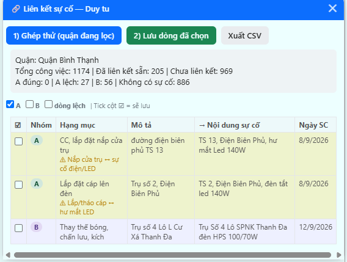
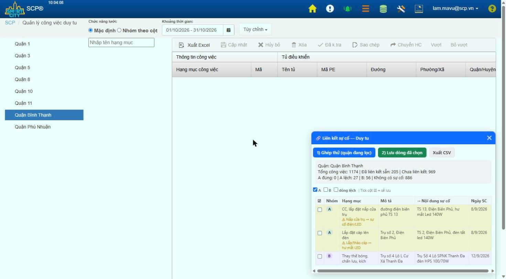

# Liên kết sự cố — Công việc Duy tu (SmartHCM / SCP)

Công cụ **userscript** chạy ngay trong trình duyệt để tự động **ghép và liên kết sự cố** cho công việc duy tu trên trang
`https://www.smarthcm.city/Maintenance/TaskListNew`.

Công cụ so **cột Mô tả** của công việc với **cột Nội dung** của bảng sự cố cùng tủ (theo số trụ + từ vị trí + loại việc),
phân nhóm, lọc các dòng ghép lệch, hiển thị bảng để duyệt, rồi lưu liên kết chỉ với các dòng được tick.

> **Bản rule-based (miễn phí, không cần AI, không cần API key).** Chạy hoàn toàn trong tab trình duyệt đã đăng nhập của bạn —
> không gửi dữ liệu đi đâu.

---

## 1. Yêu cầu

- Trình duyệt Chrome / Edge / Cốc Cốc / Firefox.
- Extension **Tampermonkey** (miễn phí): https://www.tampermonkey.net/
- Tài khoản đăng nhập được vào `smarthcm.city`.

## 2. Cài đặt

1. Cài extension **Tampermonkey** từ Chrome Web Store (hoặc store của trình duyệt bạn dùng).
2. Bấm biểu tượng Tampermonkey → **Create a new script…**
3. Xóa hết nội dung mẫu, dán toàn bộ nội dung file [`lien-ket-su-co-smarthcm.user.js`](lien-ket-su-co-smarthcm.user.js) vào.
4. Nhấn **Ctrl + S** để lưu.

> Cài một lần là xong. Lần sau mở trang TaskListNew là công cụ tự hiện.

## 3. Cách dùng

1. Mở trang **Quản lý Công việc Duy tu** (TaskListNew).
2. Lọc **Quận** và **Khoảng thời gian** như bình thường (công cụ chỉ xử lý đúng quận + thời gian đang lọc).
3. Góc phải dưới màn hình có panel **“🔗 Liên kết sự cố — Duy tu”**.
4. Bấm **“1) Ghép thử (quận đang lọc)”** → công cụ nạp lưới, lấy sự cố theo tủ và báo số liệu:
   - **A đúng** — khớp chắc (trùng số trụ + từ vị trí, trong vòng 45 ngày).
   - **A lệch** — khớp số trụ nhưng công cụ nghi ngờ ghép sai (tô vàng, bỏ tick sẵn).
   - **B** — chưa chắc (khác tên đường, chỉ trùng vật tư, hoặc nhiều sự cố ngang nhau).
   - **Không có sự cố** — không tìm được sự cố phù hợp.
5. Duyệt bảng (bật/tắt hiển thị A / B / dòng lệch). Cột **☑** đầu mỗi dòng quyết định dòng đó có được lưu hay không.
6. Bấm **“2) Lưu dòng đã chọn”** → công cụ lưu liên kết, tải lại lưới và báo số dòng lưu đúng.
7. (Tùy chọn) **“Xuất CSV”** để mở bằng Excel duyệt tay trước.

## 4. Nguyên tắc an toàn

- Luôn **chạy thử trước** (nút 1), xem bảng rồi mới lưu (nút 2).
- **Không ghi đè:** công việc đã có sự cố (API trả mã `2`) được bỏ qua.
- Mặc định chỉ tick sẵn **nhóm A không lệch**. Dòng lệch và nhóm B phải tự tick nếu muốn lưu.

## 5. Bộ lọc dòng lệch sẵn có

Công cụ tự đánh dấu “lệch” các kiểu ghép sai thường gặp:

| Kiểu lệch | Ví dụ |
|---|---|
| Nắp cửa trụ ↔ sự cố điện/LED | “CC, lắp đặt nắp cửa trụ” ↔ “hư mắt LED” |
| Lắp/tháo cáp ↔ hư mắt LED | “Lắp đặt cáp lên đèn” ↔ “đèn tắt led 140W” |
| Hẻm ↔ cầu (khác vị trí) | “hẻm 243 Chu Văn An” ↔ “cầu Chu Văn An” |
| Lắp đèn/cần đèn ↔ hư RCBO | “Lắp đặt bộ đèn” ↔ “hư RCBO” |
| Tẩy rỉ/sơn ↔ hư chóa/gãy tay | “Sơn trụ trang trí” ↔ “bể chóa / gãy tay đèn” |
| Kích/chấn lưu/tụ ↔ bễ đế bông huệ | “Thay thế kích đèn” ↔ “bễ đế đèn bông huệ” |
| Khác Lô | “Lô L” ↔ “Lô SPNK” |
| Tháo băng rôn ↔ đèn tắt | — |

> **Hạn chế:** bản rule-based **không đọc hiểu ngữ nghĩa**. Dòng lệch kiểu **mới** (chưa có trong bảng trên) có thể vẫn
> lọt vào nhóm A — hãy liếc qua bảng trước khi lưu. Gặp kiểu lệch mới, thêm vào hàm `lechReason()` trong file script.

## 6. Khắc phục sự cố

- **Không thấy panel:** kiểm tra đúng trang `/Maintenance/TaskListNew`, và Tampermonkey đang bật script.
- **Bấm Ghép thử báo lỗi:** trang có thể đổi tên hàm nội bộ. Mở Console (F12) chạy
  `Object.keys(window).filter(k => /incident|link/i.test(k))` để tìm lại, rồi cập nhật script.
- **Số liệu quận sai:** chọn lại đúng quận ở cột trái và chờ lưới nạp xong trước khi bấm Ghép thử.

## 7. Giấy phép

Dùng nội bộ. Xem [LICENSE](LICENSE).
